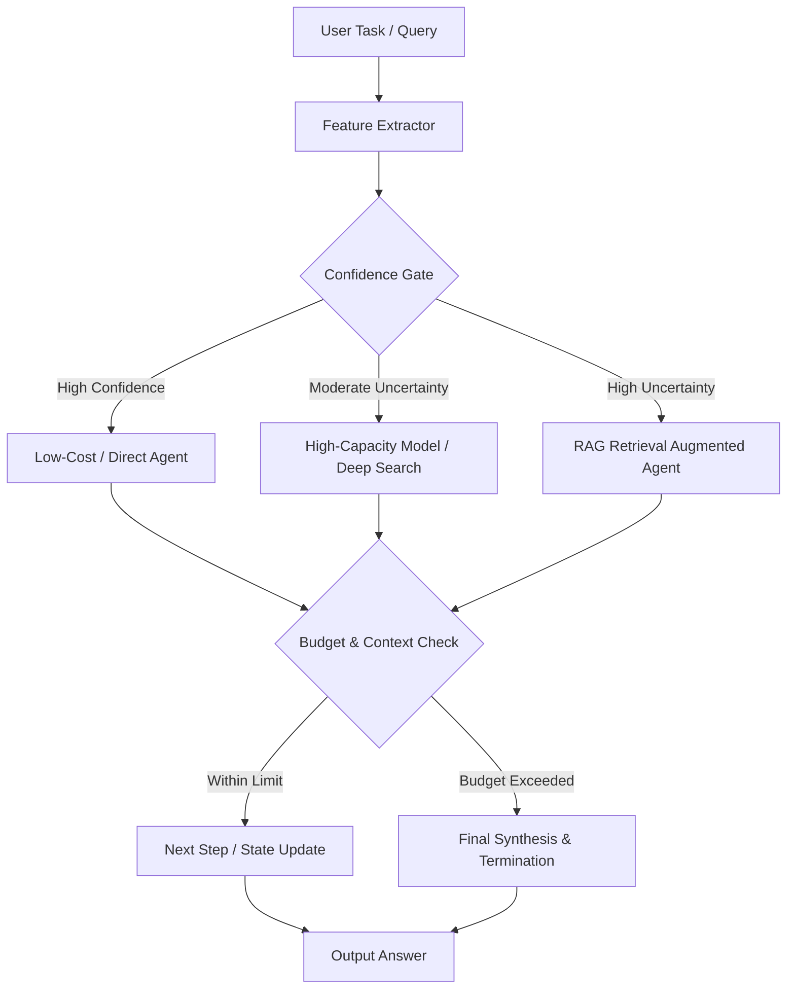

# System Architecture

## Architecture Diagram

## Core Subsystems
1. **Feature Extractor (`src/features/extractor.py`)**: Computes token entropy, likelihood stats, and step token usage.
2. **Confidence Gate (`src/gating/confidence_gate.py`)**: Applies calibrated criteria to route execution.
3. **MAR Coordinator (`src/mar/system.py`)**: Controls state transitions and interactions between agents.
4. **Context Budget Tracker (`src/evaluation/budget.py`)**: Ensures compute and token boundaries are respected.
